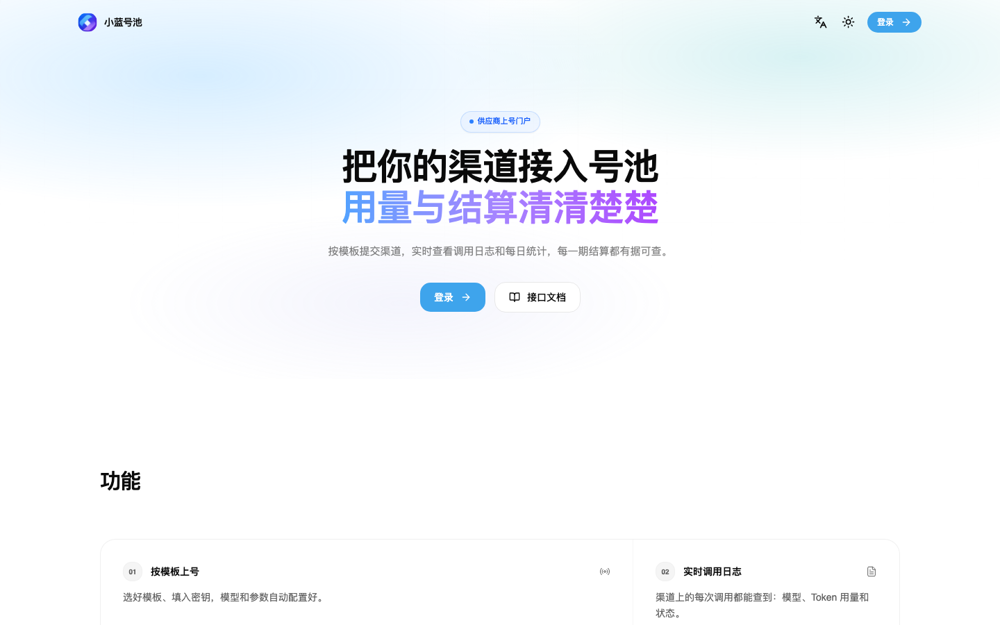
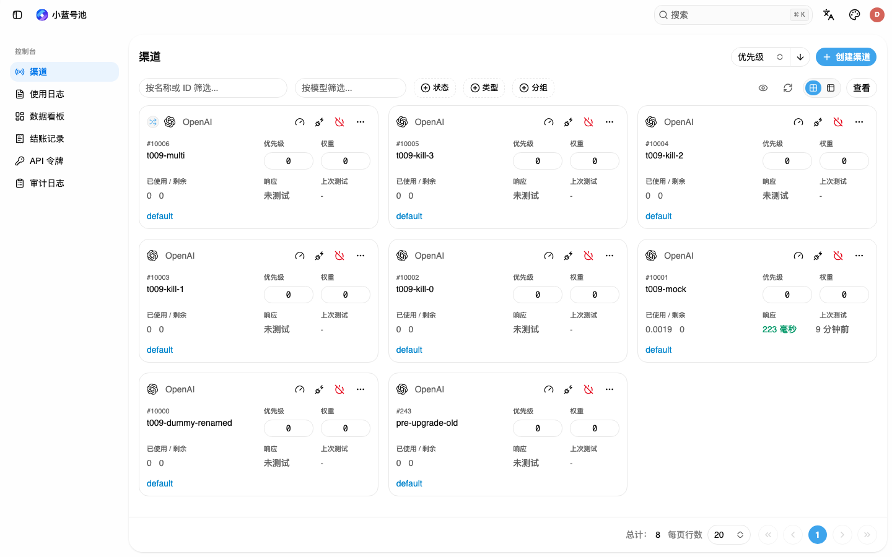
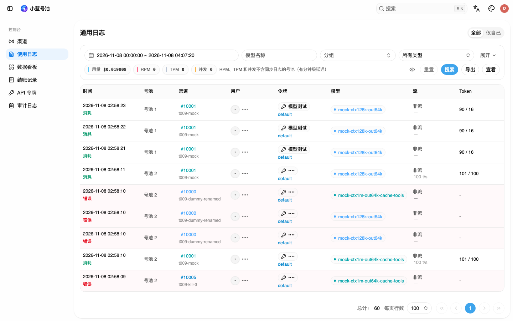
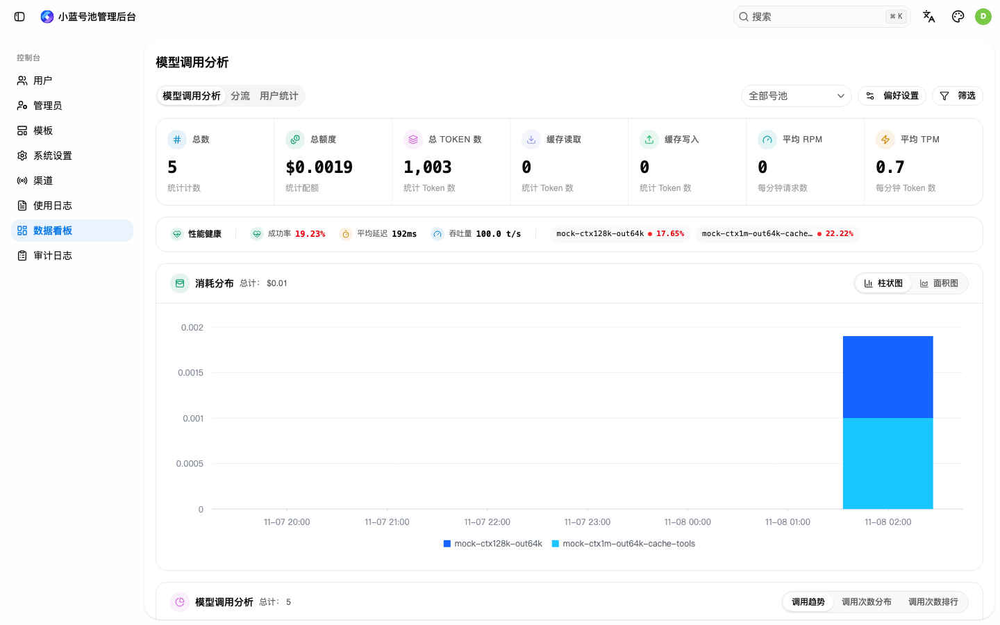
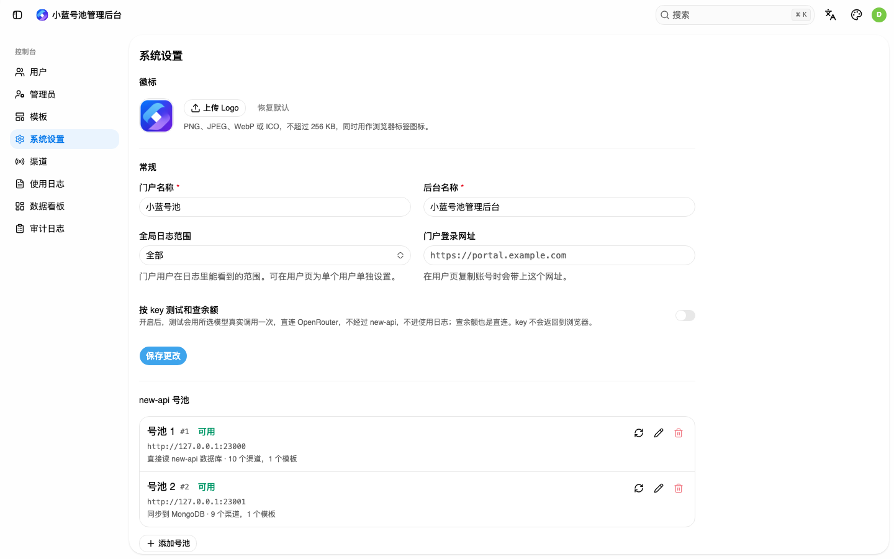

# new-api-sub

给 [new-api](https://github.com/QuantumNous/new-api) 配的供应商上号系统：供应商在**门户**自己提交渠道、看用量和结账，管理员在**后台**管账号、模板、日志和统计。不修改 new-api。



## 界面

| 门户：渠道 | 门户：使用日志 |
|---|---|
|  |  |

| 后台：数据看板 | 后台：系统设置与号池 |
|---|---|
|  |  |

## 功能

**门户（供应商用）**

- **渠道**：按管理员配好的模板上号，只填名称和密钥；可以批量上 key、改名称和模型、启用、禁用、测试、刷新余额、删除。只能看到和操作自己的渠道。
- **使用日志**：自己渠道上的每次调用，含模型、Token 用量和状态；用户、令牌、IP 打码显示。
- **数据看板**：按天、按渠道、按模型的调用次数和消耗。
- **结账记录**：已用、已结和待结金额，以及每一笔结账。
- **API 令牌和接口文档**：创建令牌后用程序上号和查询。接口文档在首页的「接口文档」按钮，不登录也能看。
- **账户安全**：改密码，绑定验证码（TOTP）或通用密钥做两步验证。
- **审计日志**：自己账号的操作记录。

**后台（管理员用）**

- **用户**：创建门户账号、重置密码、禁用、设置日志可见范围、登记结账。
- **管理员**：分超级管理员和普通管理员，普通管理员只能看到自己名下的用户和渠道。
- **模板**：决定供应商能上哪些类型的渠道，以及模型、分组等设置。
- **渠道、使用日志、数据看板**：所有供应商的渠道和用量，也可以自己上 key。
- **系统设置**：名称和 Logo；接入一个或多个 new-api（每个叫一个号池）。
- **审计日志**：所有人的操作记录。

## 怎么用

**管理员**

1. 登录后台，在「系统设置」添加号池（填 new-api 的地址和令牌）。
2. 在「模板」建渠道模板，勾选它用的号池。
3. 在「用户」创建门户账号，把登录网址、账号和密码发给供应商。
4. 之后在「渠道」「使用日志」「数据看板」看用量，在「用户」里登记结账。

**供应商**

1. 用拿到的账号登录门户。
2. 在「渠道」点「创建渠道」，选模板，填名称和密钥。
3. 在「使用日志」「数据看板」看调用和消耗，在「结账记录」对账。
4. 要用程序批量操作时，在「API 令牌」创建令牌，按[接口文档](docs/reference.md#程序接口)调用。

## 部署

门户（portal，默认 `:8081`）和后台（admin，默认 `:8082`）是两个独立进程，各有自己的端口和登录体系，共用一个自有 PostgreSQL。

集成边界：**可以接多个 new-api，每个叫一个号池。写走号池的管理 API（PAT）；日志按号池的日志模式，直读 new-api 只读数据库（direct），或由后台经 new-api 接口同步进 MongoDB 再读（sync）**。不修改 new-api。

下面是部署步骤。角色权限、配置项全表、本地开发、接口和行为细节见 [docs/reference.md](docs/reference.md)，号池、推送和日志同步见其中[「号池」](docs/reference.md#号池)一节。

## 部署结构

```
CDN（终止 TLS）→ HTTP 回源 → entry（Nginx）→ portal / admin → appdb（自有 PostgreSQL）
                                                  ├─ mongo（同步来的日志，保留 30 天）
                                                  └─ 各号池的 new-api（管理 API + 只读数据库）
```

`deploy/compose.yaml` 一次起全部服务，只有 `entry` 对外发布端口。`mongo` 只接内部网络，两个应用不依赖它启动：它挂了只影响同步号池的日志。

准备好：

- Docker 和 Docker Compose
- 一个或多个运行中的 new-api，使用 PostgreSQL 或 MySQL，且 `logs` 表带 `upstream_request_id` 列
- 门户和后台各一个域名，以及一个能终止 TLS、能覆盖 `X-Real-IP` 请求头的 CDN 或反向代理

## 1. new-api 侧准备

每个号池的 new-api 各做一遍。日志模式为 sync 的号池可以不配数据库，只做第 1 项（PAT 要带 `log:read`），第 3–5 项跳过。

1. **PAT**：用 root 账号（或被授予 `channel:sensitive_write` 的管理员）在 new-api 面板创建个人访问令牌（`nap_` 开头），scope 勾选下表各项。`log:read` 只有同步日志的号池需要（开了日志同步或日志模式为 sync），直读号池的日志与统计走只读库，不需要它。启动时只验证 `channel:read`，同步号池的「测试连接」另验证日志导出：

   | scope | 用到的接口 |
   |---|---|
   | `channel:read` | `GET /api/channel/`（启动时验证 PAT）、`GET /api/channel/models`、`GET /api/channel/default_base_urls`（super 的模板抽屉） |
   | `channel:write` | `PUT /api/channel/`（编辑渠道名称和模型） |
   | `channel:operate` | `POST /api/channel/:id/status`（启停、软删除前禁用）、`GET /api/channel/test/:id`（测试）、`GET /api/channel/update_balance/:id`（刷新余额）、`POST /api/channel/multi_key/manage`（多 key 渠道查看和开关单个 key，只用 `get_key_status`、`enable_key`、`disable_key`） |
   | `channel:sensitive_write` | `POST /api/channel/`（新增）、`DELETE /api/channel/:id`（仅新增后登记失败时的补偿删除）、`POST /api/channel/fetch_models`（super 的模板抽屉「从上游获取」） |
   | `group:read` | `GET /api/group/`、`GET /api/prefill_group/`。仅 super 的模板抽屉使用；缺少时对应选项报错，其余功能不受影响 |
   | `log:read` | `GET /api/log/export`（仅同步号池：按时间窗口导出日志写进 MongoDB） |

   `GET /api/status`（读取 `quota_per_unit`）为公开接口，不需要 scope。没有数据库的号池另用 `GET /api/channel/`（`channel:read`）读渠道状态和按 `remark` 反查新建的渠道。

   **同步号池建议单独建一个 new-api 用户**来创建这个 PAT，不要拿它在 new-api 面板手动导出日志：new-api 同一个用户同时只能有一个日志导出，有人用同一用户导出时同步会一直退避。

   **权限审查结论**：上表加这个公开接口就是本系统调用 new-api 的全部接口。写操作只有新增渠道、编辑名称和模型、启停（含多 key 渠道的单个 key）、测试、刷新余额、从上游获取模型列表；软删除只是禁用加本地标记，清理映射只删本地记录；除新增后登记失败时的补偿删除，不会调用 DELETE。编辑的请求体只有 `id`、`name`、`models`，必要时加 `test_model`，不修改密钥、地址、分组等其他字段。`log:read` 只读日志。所有渠道操作都先按本地归属校验范围。

   **固有风险**：new-api 的 scope 粒度粗，这个 PAT 能做的事多于本系统做的事。`channel:sensitive_write` 同时放开了 `DELETE /api/channel/disabled`、批量删除等接口，也允许 `PUT /api/channel/` 修改密钥和地址；这些限制在本系统代码里，new-api 不会拦。PAT 泄露等于失去这些限制，须按 root 级凭据保管，泄露后立即吊销。
2. **建议环境变量**：`ERROR_LOG_ENABLED=true`（否则统计里的错误数恒为 0）。
3. **只读数据库账号**：对 `channels` 只授权下列列（**不授权 `key`**，也不授权 `other/settings/setting/param_override/header_override/model_mapping/status_code_mapping/open_ai_organization`；`remark` 只用于新增渠道后按一次性标记反查 id，不对外返回；`channel_info` 中的多 key 错误原因不对外返回），对 `logs` 授权 SELECT。PostgreSQL 示例：
   ```sql
   CREATE ROLE newapi_ro LOGIN PASSWORD '...';
   GRANT SELECT (id, type, name, status, base_url, models, "group", priority, weight,
                 used_quota, balance, balance_updated_time, created_time, test_time, response_time,
                 tag, test_model, auto_ban, channel_info, other_info, remark) ON channels TO newapi_ro;
   GRANT SELECT ON logs TO newapi_ro;
   ```
   MySQL 示例（库名按实际替换；日志库独立时对日志库的 `logs` 单独授权）：
   ```sql
   CREATE USER 'newapi_ro'@'%' IDENTIFIED BY '...';
   GRANT SELECT (id, type, name, status, base_url, models, `group`, priority, weight,
                 used_quota, balance, balance_updated_time, created_time, test_time, response_time,
                 tag, test_model, auto_ban, channel_info, other_info, remark) ON `new-api`.channels TO 'newapi_ro'@'%';
   GRANT SELECT ON `new-api`.logs TO 'newapi_ro'@'%';
   ```
   日志查询读 `logs.upstream_request_id`，new-api 须为带这一列的版本，否则日志接口直接报错。

   再限制这个账号对 new-api 数据库的压力。日志对所有角色开放，查询和导出会扫全表。上限按号池分别算，每个配了主库的号池（不论日志模式）按“每进程常驻 + 校验时临时”算：portal、admin 每个进程常驻最多 10 个连接（渠道 3、日志 7），两进程 20；admin「测试连接」和保存时另开主库、日志库各 1 个临时连接，用完即关，共 2 个。所以上限至少 22，否则测试和保存会报“数据库连接数已满”；正常使用不会触发。日志导出每个进程同时最多 2 个，单次最长 30 分钟。日志库独立时，主库账号至少 7（3 × 2 + 1），日志库账号至少 15（7 × 2 + 1）。PostgreSQL：
   ```sql
   ALTER ROLE newapi_ro CONNECTION LIMIT 22;
   ALTER ROLE newapi_ro SET statement_timeout = '30min';
   ```
   MySQL：
   ```sql
   ALTER USER 'newapi_ro'@'%' WITH MAX_USER_CONNECTIONS 22;
   ```
   有只读副本时，把 `NEWAPI_LOG_DB_DSN` 指向副本，日志查询就不再压主库。`NEWAPI_DB_DSN` 留在主库：新增渠道后要按 `remark` 立刻反查，副本延迟会把成功报成失败。

   只支持 PostgreSQL 与 MySQL（SQLite / ClickHouse DSN 启动即报错）。日志库独立部署（new-api 的 `LOG_SQL_DSN`）时设置 `NEWAPI_LOG_DB_DSN`。
4. 经 PgBouncer 事务池连接时，在 DSN 加 `default_query_exec_mode=simple_protocol`。
5. **可选：按 key 测试/余额需要专用只读角色**。多 key 的 OpenRouter 渠道要逐个 key 测试、查余额时，本系统须读出 key 直连 OpenRouter，这需要一个只能读 `channels` 的 `id`、`key`、`model_mapping`、`param_override` 四列的独立角色（上面的 `newapi_ro` 不能读 `key`，也不要给它加）。不需要这个功能就跳过，`NEWAPI_KEY_DB_DSN` 留空即可，其他功能不受影响。PostgreSQL：
   ```sql
   CREATE ROLE newapi_key_ro LOGIN PASSWORD '...' CONNECTION LIMIT 5;
   GRANT SELECT (id, key, model_mapping, param_override) ON channels TO newapi_key_ro;
   ```
   MySQL：
   ```sql
   CREATE USER 'newapi_key_ro'@'%' IDENTIFIED BY '...' WITH MAX_USER_CONNECTIONS 5;
   GRANT SELECT (id, `key`, model_mapping, param_override) ON `new-api`.channels TO 'newapi_key_ro'@'%';
   ```
   每个进程常驻最多 2 个连接，两个进程合计 4；admin「测试连接」和保存时再临时开 1 个，用完即关，所以上限 5。设成 4 时测试和保存会报“数据库连接数已满”。配好后还要由 super 在后台「系统设置」打开「按 key 测试和查余额」（默认关闭）。测试会用所选模型真实调用一次，产生费用，见[参考手册](docs/reference.md#多-key-渠道)。

   **从只授权了 `id`、`key` 的版本升级**：先执行上面的 `GRANT` 补上 `model_mapping`、`param_override` 两列，再换镜像，否则按 key 测试和查余额都会失败（500，日志里是权限错误）。PAT 需要 `channel:operate`（`POST /api/channel/multi_key/manage`，用于查看和开关单个 key）。

## 2. 准备镜像

**用发布好的镜像**：每个版本的镜像在 GitHub 的 Releases 页，地址是 `ghcr.io/pomoai-ai/new-api-sub/{portal,admin}:<版本>`，发布说明里有带 digest 的两行，直接填进下一步的配置。推送 `v` 开头的标签时由 `.github/workflows/release.yml` 构建和发布。

**用 GitLab CI**：推送默认分支后，`.gitlab-ci.yml` 构建前端和二进制，做密钥和依赖扫描、部署配置校验，发布到 `$CI_REGISTRY_IMAGE/{portal,admin}:<commit>`，再校验 Registry 中的镜像。`registry_verify` 的产物 `release.env` 就是下一步要填的两行镜像地址（带 digest）。CI 不跑测试。

**自己构建**：需要 Go 1.25+（发布建议 1.26.10：1.25 最新版本仍有未修复的标准库漏洞）和 bun。

```sh
make web
CGO_ENABLED=0 GOOS=linux GOARCH=amd64 go build -trimpath -ldflags='-s -w' -o build/portal ./cmd/portal
CGO_ENABLED=0 GOOS=linux GOARCH=amd64 go build -trimpath -ldflags='-s -w' -o build/admin ./cmd/admin
docker build --build-arg APP=portal -t new-api-sub-portal:local .
docker build --build-arg APP=admin -t new-api-sub-admin:local .
```

## 3. 填写配置

```sh
cp deploy/.env.example deploy/.env && chmod 600 deploy/.env
```

| 变量 | 说明 |
|---|---|
| `PORTAL_IMAGE`、`ADMIN_IMAGE` | 上一步的镜像地址 |
| `ENTRY_BIND` | CDN 回源连接的地址和端口，如 `<公网 IP>:80` |
| `EDGE_SUBNET` | `entry` 所在网段，不能和宿主机上其他网络重叠 |
| `APP_DB_PASSWORD` | `openssl rand -hex 32`。它会拼进 DSN，不能用 base64：其中的 `/` 会让 DSN 解析失败，容器起不来 |
| `PORTAL_SESSION_SECRET`、`ADMIN_SESSION_SECRET` | 各用一次 `openssl rand -base64 48`，两个必须不同 |
| `APP_MASTER_KEY` | `openssl rand -hex 32`，两个进程共用。加密自有库里的谷歌验证码密钥、各号池的连接信息和供应商提交的渠道 key，缺失时两个进程都起不来。保管见下文 |
| `MONGO_PASSWORD` | `openssl rand -hex 24`。MongoDB 的密码，会拼进 `MONGO_URI`，不能用 base64 |
| `PORTAL_PUBLIC_ORIGIN`、`ADMIN_PUBLIC_ORIGIN` | 用户访问门户、后台的地址，如 `https://portal.example.com`，只写协议和域名，不带路径。通用密钥绑定在这个域名上，改了已绑定的通用密钥全部失效 |
| `NEWAPI_NETWORK` | new-api 所在的 docker 网络（`docker network ls`）。两个系统加入它，用容器名访问 new-api 和它的数据库，数据库不需要对宿主机发布端口。new-api 不在同一台机器时，建一个空网络填进去 |
| `NEWAPI_BASE_URL`、`NEWAPI_PAT`、`NEWAPI_DB_DSN`、`NEWAPI_LOG_DB_DSN`、`NEWAPI_KEY_DB_DSN` | 新装留空，见下文「号池」。只在自有库从未有过号池时读取一次，导入为「号池 1」，之后不再读 |

**号池**在后台「系统设置 → 号池」添加，仅 super 可用。每个号池是一个 new-api：

| 项 | 说明 |
|---|---|
| 名称 | 全局唯一。**门户用户能看到号池名称**（渠道的推送状态、日志和统计按号池分开），不要用内部地址、客户名等不想让供应商看到的名字 |
| 地址 | new-api 地址，如 `http://<new-api 容器名>:3000`；不在同一台机器时写可达地址。同一个 new-api 不能配成两个号池 |
| PAT | 第 1 步创建的令牌 |
| 日志模式 | `direct` 直读主库或日志库（号池 1 默认）；`sync` 读同步进 MongoDB 的日志，只能查最近 30 天 |
| 接收新渠道 | 关掉后新提交的渠道不再推到这个号池，已有的照常 |
| 主库 | 第 1 步的只读账号，如 `postgres://newapi_ro:<密码>@<数据库容器名>:5432/<库名>?sslmode=disable`。日志模式为 sync 时可留空 |
| 日志库 | 可选，日志库独立或用只读副本时填写，空为同主库 |
| key 库 | 可选，第 1 步第 5 项的专用角色。保存前会检查主库、日志库的角色确实读不到 `key`，读得到就拒绝保存。留空则按 key 测试和查余额不可用 |

首次启动时还没有号池，后台进入受限模式：能登录、能改账号和系统设置，其余接口 503，门户启动失败并由 Docker 重启。super 登录后添加号池，先点「测试连接」，保存时要再验证身份（两步验证或密码），校验通过才保存。每次保存或删除号池（包括只改名称），portal、admin 都在约 10 秒内自行退出，由 `restart: unless-stopped` 拉起后用新配置；日志同步的开关和频率不重启。PAT、连接串加密存库，页面只显示是否已设置和去掉账号密码的主机，任何人都读不回明文。改地址时必须同时重填 PAT，并确认：换到另一个 new-api 后，已投放渠道的 id 对不上。某个号池连不上只降级这个号池，其余照常。

渠道模板要勾选推送到哪些号池。远端号池的日志要同步时，在号池卡片的「日志同步」里打开，见[参考手册](docs/reference.md#日志同步)。

**主密钥保管**：`APP_MASTER_KEY` 不要和 appdb 的备份放在一起，否则拿到备份的人能解出 PAT、连接串和供应商提交的 key。丢失后，所有谷歌验证码失效（备份码、通用密钥仍可登录，其余由管理员重置两步验证），每个号池要在后台重新填写全部信息，还没推送完的渠道再也推不出去。不支持轮换。

再把 `deploy/nginx.conf` 里的 `portal.example.com`、`admin.example.com` 换成实际域名。其他 Host 的请求会被直接断开。

## 4. 启动

```sh
docker login <registry>   # 用 CI 镜像时，用只读 Registry 凭据
docker compose -f deploy/compose.yaml up -d
docker compose -f deploy/compose.yaml ps
```

同机还有别的项目用这个 Registry 时，给 `docker login` 和 `docker compose` 设同一个单独的 `DOCKER_CONFIG`，否则会覆盖原有凭据。

## 5. 配置 DNS 和 CDN

门户和后台域名都 CNAME 到 CDN 给的加速地址，各域名的 CDN 配置相同：

| 项 | 值 |
|---|---|
| 回源 | HTTP，地址和端口为 `ENTRY_BIND` |
| 回源 Host | 访问域名（不能改写） |
| 真实客户端 IP 头 | `X-Real-IP`，必须由边缘覆盖客户端传入的同名头 |
| 回源读超时 | ≥ 125 秒（渠道测试最长 90 秒） |
| 缓存 | 只缓存 `/static/*`（文件名带内容哈希）；其余全部不缓存，包括 `/`、`/api/*` 和 3xx/4xx/5xx |
| HTTPS | 强制跳转；证书在边缘 |
| WAF | 不要对 `/api/*` 用 JS 挑战或验证码，前端是 XHR，挑战页会让接口失败 |

入口信任边缘写入的 `X-Real-IP`，不校验回源来源：源站地址可被直连时，审计里的 IP 可被伪造（登录限流按用户名，不受影响）。建议源站只放行 CDN 回源，或在回源请求头加密钥头并在入口 Nginx 校验；回源走公网时改用 HTTPS 或内网隧道。

## 6. 上线验证

经 CDN 访问时带一个伪造头 `curl -H 'X-Real-IP: 1.2.3.4' https://portal.example.com/api/auth/login -d '{}'`，到后台操作日志查 `auth.login` 记录的 IP：应是你的真实 IP，不是 `1.2.3.4`。如果是 `1.2.3.4`，说明 CDN 没有覆盖这个头，审计里的 IP 不可信，先改 CDN 再开放。

## 7. 首次登录

首次启动 admin 后（此时处于受限模式，见第 3 步「号池」），从日志里找到随机生成的超级管理员（`docker compose -f deploy/compose.yaml logs admin | grep 首次启动`）登录，再从右上角头像菜单修改账号和密码，建议在「账户安全」绑定谷歌验证码或通用密钥；账号保存前不要重建容器，重建后日志就没了。随后：先添加号池（见第 3 步），再建渠道模板（类型 1 OpenAI、14 Anthropic、20 OpenRouter、57 Codex；Codex 的 key 为含 `access_token`、`account_id` 的 JSON；每个模板至少勾选一个号池），再创建管理员与门户用户。

## 升级与备份

**升级**：更新 `deploy/.env` 里的镜像地址，再执行 `docker compose -f deploy/compose.yaml up -d`。portal 和 admin 始终换同一版本。从环境变量配置 new-api 的版本升级时，先按[参考手册](docs/reference.md#升级与回退)加主密钥和两个地址变量。

**升级到多号池版本**（带 `mongo` 服务的版本）：

1. 备份 appdb（`docker compose -f deploy/compose.yaml exec -T appdb pg_dump -U app app > appdb-<日期>.sql`），保留旧的 `deploy/.env` 和 `compose.yaml`。
2. 换上新的 `compose.yaml`，在 `deploy/.env` 加 `MONGO_PASSWORD`（`openssl rand -hex 24`），更新两个镜像地址。
3. `docker compose -f deploy/compose.yaml up -d`：portal、admin 同一版本一起起来，`mongo` 一并创建。
4. 后台「系统设置 → 号池」应出现「号池 1」（由原来的 new-api 连接迁移而来，日志模式 direct）；渠道列表里老渠道的编号和原来一样，推送状态为完成。渠道模板都已勾选号池 1。
5. 接入远端号池：添加号池（PAT 带 `log:read`），在模板里勾选它；在它的「日志同步」里打开同步。它有只读库时先保持 direct，同步跑一段时间后用「对账最近 24 小时」核对条数和额度一致，再决定是否改成 sync。

**不支持回退到升级前的镜像**：升级后新建的渠道编号从 10000 起（或从原最大编号加 1），旧版会把它们当成号池 1 的 new-api 渠道 id，号池 1 自己的 id 涨到这里时会串号。

自有库 schema 在每次启动时自动迁移：`schema.sql` 只用 `CREATE ... IF NOT EXISTS`、`ADD COLUMN IF NOT EXISTS`、`DROP INDEX IF EXISTS`、`ON CONFLICT DO NOTHING` 的种子和可重复执行的回补语句，新版本加的表、列和设置项会补到旧库上，已有数据不动。升级前仍建议先备份。版本相关的步骤和回退注意事项见[参考手册](docs/reference.md#升级与回退)。

**备份**：应用数据在 `appdb` 卷，需要纳入备份，审计、软删除记录和供应商提交的 key（主密钥加密）都在里面。`mongodata` 卷只是同步来的日志的缓存（最多 30 天），可以不备份：丢了以后对每个同步号池点「清空并重新同步」，从 new-api 重新读回最多 30 天（以 new-api 里还留着的为限）。

## 许可证

本项目按 [GNU AGPL-3.0](LICENSE) 授权。`web/ui` 是 [new-api](https://github.com/QuantumNous/new-api) 前端的修改版本，附加条款和修改说明见 [`web/ui/NOTICE`](web/ui/NOTICE)。

修改后对外提供服务时，须向使用者提供所运行版本的完整源码（AGPL 第 13 条），并保留界面上的署名和原项目链接。部署配置和密钥不属于要提供的源码。

<sub>Frontend design and development by New API contributors. [github.com/QuantumNous/new-api](https://github.com/QuantumNous/new-api)</sub>
